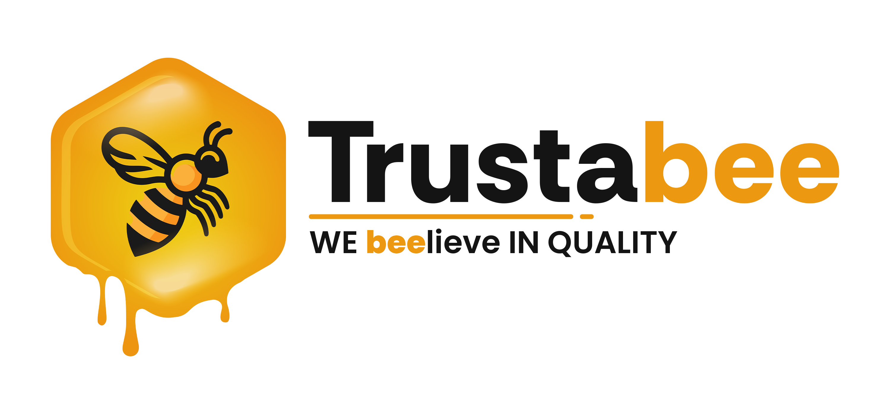

<div align="center">



**A marketplace MVP that connects Sri Lankan honey farmers with UK buyers.**


</div>

> **Note:** This project is an MVP (Minimum Viable Product) built to quickly validate core features and user experience.

## Features

- **For farmers:** onboarding, honey sample submission, verification status, badges, and an export journey tracker on a personal dashboard
- **For buyers:** browse verified honey, save favourites, manage a cart and track orders
- **For admins:** review and approve farmer verifications
- Sign-in and registration, with separate import and export welcome flows

## Getting Started

1. **Install dependencies:**
   ```bash
   npm install
   ```
2. **Start the development server:**
   ```bash
   npm run dev
   ```

To run MongoDB locally, `scripts/setup-mongodb.sh` starts `mongod` with its data in `./data/db`.

## Scripts

- `npm run dev` — Development server
- `npm run build` — Production build
- `npm run preview` — Preview production build
- `npm run lint` — Lint code

## Tech Stack

- Vite
- React
- TypeScript
- Redux Toolkit (with redux-persist)
- React Router
- Tailwind CSS
- AWS Amplify
- MongoDB

## License

[MIT](LICENSE)
